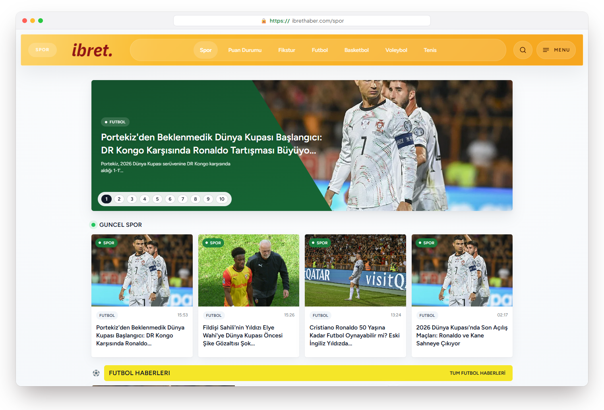
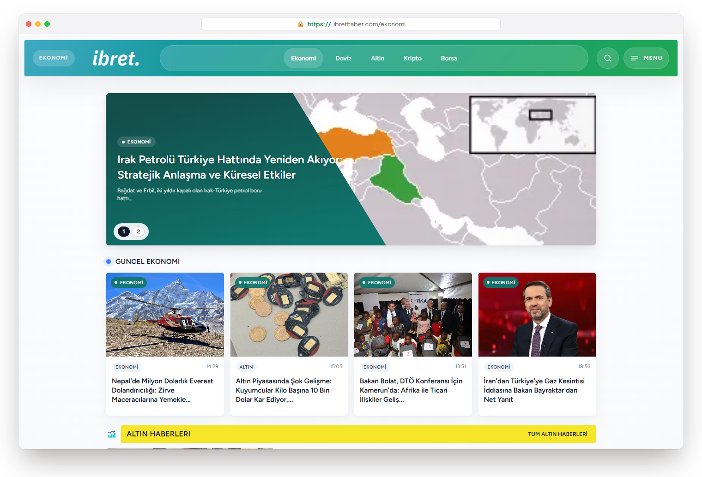

 

[Website](https://ibrethaber.com) &nbsp;·&nbsp; [Screenshots](#screenshots) &nbsp;·&nbsp; [Features](#features) &nbsp;·&nbsp; [Tech Stack](#tech-stack) &nbsp;·&nbsp; [Contact](#contact)

 

> [!IMPORTANT]
> This repository is a showcase only. ibrethaber.com is a closed-source product and its source code is kept in a private repository. What you will find here is an overview of the project, screenshots and the license terms.

## About

[ibret.](https://ibrethaber.com) is a Turkish online news platform covering breaking news, world affairs, economy, sports, politics, technology, entertainment, health and culture.

I built it from the ground up: the public website, the editorial back office used to publish content, and the server setup behind it. The aim was simple. A news site that loads fast, reads well on a phone and stays out of the reader's way, while still giving editors the tools a real newsroom needs.

<table>
<tr>
<td align="center" width="25%"><h3>10+</h3>news categories</td>
<td align="center" width="25%"><h3>4</h3>sports sub-sections</td>
<td align="center" width="25%"><h3>4</h3>market data pages</td>
<td align="center" width="25%"><h3>100%</h3>responsive</td>
</tr>
</table>

## Screenshots

### Homepage

<b>View the full homepage</b>

 

### Articles and categories

<table>
<tr>
<td width="50%">
Article page
</td>
<td width="50%">
Category page, World
</td>
</tr>
<tr>
<td width="50%">
Category page, Politics
</td>
<td width="50%">
Navigation drawer
</td>
</tr>
</table>

### Category themes

Each section has its own color. The header, accents and highlights switch automatically depending on which part of the site you are reading.

<table>
<tr>
<td width="50%">
Sports
</td>
<td width="50%">
Economy
</td>
</tr>
</table>

### Mobile

## Features

<table>
<tr>
<td valign="top" width="50%">

**Reading experience**
- Headline slider with numbered pagination
- Breaking news feed with timestamps
- Featured headline carousel with a vertical index
- Most read stories of the week
- Clean article layout with related content
- Columnists section
- Photo and video galleries

</td>
<td valign="top" width="50%">

**Sections and services**
- World, Türkiye, Politics, Economy, Sports, Magazine, Technology, Health, Culture and Arts
- Football, basketball, volleyball and tennis under Sports
- Currency, gold, stock market and crypto pages under Economy
- On-duty pharmacy finder
- Tag-based content discovery

</td>
</tr>
<tr>
<td valign="top" width="50%">

**Design**
- Mobile-first, fully responsive layout
- Per-category color themes
- Tabbed sidebar widgets for sports, economy, magazine and gold
- Full-screen navigation drawer and search
- Lazy-loaded images

</td>
<td valign="top" width="50%">

**Platform**
- Custom editorial admin panel
- Category, tag, author and media management
- SEO: clean URLs, canonical tags, Open Graph and Twitter Cards, JSON-LD, XML sitemap, RSS
- KVKK, privacy, cookie and terms pages
- CSRF protection, secure sessions, HTTPS

</td>
</tr>
</table>

## Tech Stack

| Layer | Technology |
|:--|:--|
| Backend | PHP 8.3, Laravel |
| Frontend | Blade templates, vanilla JavaScript, CSS3 |
| Server | Apache, HTTPS |
| Design | Custom UI, designed from scratch |

## Status

The site is live at [ibrethaber.com](https://ibrethaber.com) and in active development. New sections and improvements ship regularly.

## License

Copyright © 2026 noutrexx. All rights reserved.

This is proprietary software and the source code is not publicly available. No part of this project, including its design, branding, logo and screenshots, may be copied, modified, distributed or reused without prior written permission. The full terms are in [LICENSE](LICENSE).

News content and photographs that appear in the screenshots belong to their respective owners and are shown for demonstration purposes only.

## Contact

If you are interested in the project, want to collaborate or are looking for a similar platform, feel free to get in touch.

- Website: [ibrethaber.com](https://ibrethaber.com)
- Contact form: [ibrethaber.com/iletisim](https://ibrethaber.com/iletisim)
- GitHub: [@noutrexx](https://github.com/noutrexx)

 
Designed and developed by <a href="https://github.com/noutrexx">noutrexx</a> and loex

